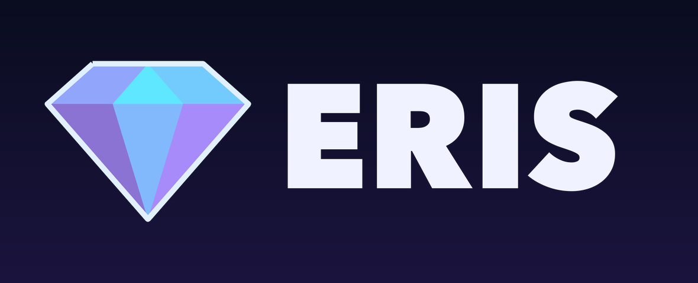

<p align="center">
  
</p>

# Eris A0

Eris A0 is a 338M-parameter Turkish-English language model trained **from scratch** by Kristalsoft
(Eren Koçakgöl): own tokenizer, own architecture, 9.63B tokens of pre-training on a single TPU chip,
followed by supervised fine-tuning. Weights and the code in this repository are released under the
Apache-2.0 license.

| | |
|---|---|
| Chat model | [kristalsoft/Eris-A0-Instruct](https://huggingface.co/kristalsoft/Eris-A0-Instruct) |
| Base model | [kristalsoft/Eris-A0-Base](https://huggingface.co/kristalsoft/Eris-A0-Base) |
| Demo (runs in your browser) | [huggingface.co/spaces/kristalsoft/Eris-A0](https://huggingface.co/spaces/kristalsoft/Eris-A0) |

[Türkçe açıklama aşağıda.](#türkçe)

## What is in this repository

| Folder | Contents |
|---|---|
| `modeling/` | Model definition for Hugging Face transformers (`configuration_eris.py`, `modeling_eris.py`), the same code that ships with the model repositories |
| `examples/` | Command-line chat (`chat.py`) and text completion (`complete.py`) |
| `evaluation/` | The benchmark code used for the model cards: cloze tasks, bits per byte and tokenizer fertility for any causal LM on the Hub (`eval_suite.py`), and official lm-evaluation-harness runs for TurkishMMLU and Belebele-TR (`lmeval_run.py`) |
| `onnx_export/` | Export to ONNX with a KV cache and int8 quantization, used by the browser demo |
| `web/` | Source of the browser demo (ONNX Runtime Web, no server) |
| `tests/` | Unit tests for the model code |

Pre-training and fine-tuning code is not part of this repository.

## Quick start

```bash
pip install torch transformers
```

```python
from transformers import AutoModelForCausalLM, AutoTokenizer

repo = "kristalsoft/Eris-A0-Instruct"
tokenizer = AutoTokenizer.from_pretrained(repo, trust_remote_code=True)
model = AutoModelForCausalLM.from_pretrained(repo, trust_remote_code=True)
print(model.chat(tokenizer, "Türkiye'nin başkenti neresidir?"))
```

Command line:

```bash
python examples/chat.py
python examples/chat.py -q "Fotosentez nedir? Kısaca açıkla."
python examples/complete.py "İstanbul Boğazı'nın iki yakası"
```

## Architecture

* 24 pre-norm decoder layers, hidden size 1024, SwiGLU (2816), RMSNorm, 4,096-token context
* Grouped-query attention (16 query heads, 4 key/value heads, head dimension 64) with QK-norm and a
  per-head sigmoid output gate
* Hybrid attention: 3 of every 4 layers use a 1,024-token local window, every 4th layer is global
* RoPE with base 10,000 (local) and 1,000,000 (global); tied embeddings; tanh logit soft-capping (30)
* Byte-level BPE tokenizer with 65,536 entries that keeps Turkish suffixes intact

See the model cards for training data, training details, intended use and limitations.

## Evaluation

```bash
pip install -r requirements.txt
python -m evaluation.eval_suite --models eris-a0-base tr-gpt2-large qwen3-0.6b --limit 200
python -m evaluation.lmeval_run --model eris-a0-base
python -m evaluation.report
```

`python -m evaluation.eval_suite --list` shows all models and tasks. Every model is loaded through
transformers and scored with the same code, so the numbers are comparable across models.

## Tests

```bash
pip install pytest
python -m pytest tests
```

## License

Apache-2.0. See [LICENSE](LICENSE). Datasets used for training and evaluation keep their own licenses.

## Contact

Kristalsoft offers task-specific fine-tuning, on-premise deployment and custom language model development.
E-mail: support@kristalsoft.com.tr

---

## Türkçe

Eris A0, Kristalsoft (Eren Koçakgöl) tarafından **sıfırdan** eğitilmiş, 338M parametreli Türkçe-İngilizce bir
dil modelidir. Tokenizer ve mimari bize ait; tek bir TPU çipinde 9.63 milyar tokenlık ön eğitimin ardından
denetimli ince ayar yapıldı. Ağırlıklar ve bu depodaki kod Apache-2.0 lisanslıdır.

* Sohbet modeli: [kristalsoft/Eris-A0-Instruct](https://huggingface.co/kristalsoft/Eris-A0-Instruct)
* Ön eğitimli model: [kristalsoft/Eris-A0-Base](https://huggingface.co/kristalsoft/Eris-A0-Base)
* Tarayıcıda çalışan demo: [huggingface.co/spaces/kristalsoft/Eris-A0](https://huggingface.co/spaces/kristalsoft/Eris-A0)

### Bu depoda neler var

* `modeling/`: Hugging Face transformers için model tanımı (model depolarındakiyle aynı kod)
* `examples/`: terminalden sohbet ve metin tamamlama
* `evaluation/`: model kartlarındaki ölçümlerin kodu. Hub'daki her nedensel dil modelini aynı yöntemle ölçer
  (cloze görevleri, bit/bayt, kelime başına token); TurkishMMLU ve Belebele-TR için resmi
  lm-evaluation-harness koşusu
* `onnx_export/`: KV-cache'li ONNX'e çevirme ve int8 sıkıştırma (tarayıcı demosu bunu kullanır)
* `web/`: tarayıcı demosunun kaynağı (sunucu yok, model ziyaretçinin cihazında çalışır)
* `tests/`: model kodunun testleri

Ön eğitim ve ince ayar kodu bu depoda yer almaz.

### Hızlı başlangıç

```python
from transformers import AutoModelForCausalLM, AutoTokenizer

repo = "kristalsoft/Eris-A0-Instruct"
tokenizer = AutoTokenizer.from_pretrained(repo, trust_remote_code=True)
model = AutoModelForCausalLM.from_pretrained(repo, trust_remote_code=True)
print(model.chat(tokenizer, "Türkiye'nin başkenti neresidir?"))
```

### İletişim

Göreve özel ince ayar, kurum içi kurulum ve dil modeli geliştirme için: support@kristalsoft.com.tr
